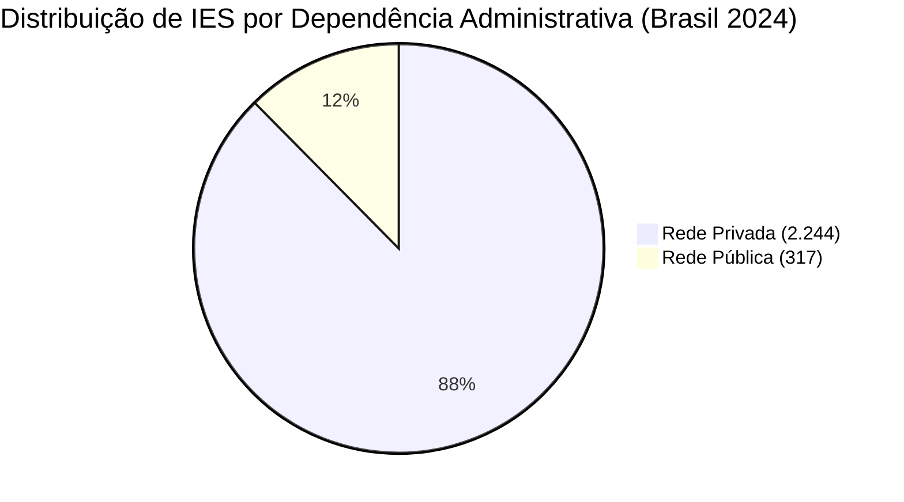

# Relatório de Engenharia e Análise de Dados: Ensino Superior 2024
**Grupo 2 — Educação: Ensino Superior**  
**Fonte dos Dados:** INEP / MEC — Sinopse Estatística da Educação Superior 2024  
**Pilar de Limpeza:** Resolução de cabeçalhos hierárquicos mesclados e desagregação territorial  
**Base Analisada:** Tabela 1.1 da planilha `Sinopse_Educação_Superior_Municipio_2024.xlsx`

---

## 1. Contexto e Objetivos do Estudo

A **Sinopse Estatística da Educação Superior** é o relatório anual consolidado divulgado pelo INEP com os dados oficiais do Censo da Educação Superior no Brasil. 

Historicamente, esse arquivo é diagramado no formato Microsoft Excel visando prioritariamente a **apresentação visual e a leitura humana** (relatórios de gabinete, consultas manuais e impressão). Por conta disso, a planilha apresenta características problemáticas para a análise de dados automatizada:
- Múltiplas linhas de cabeçalho mescladas horizontal e verticalmente;
- Células mescladas que chegam vazias (`NaN`) na leitura de bibliotecas padrão como o Pandas;
- Concomitância de totais nacionais, regionais, estaduais e municipais dentro de uma mesma coluna;
- Uso de caracteres tipográficos (como o traço `"-"`) para denotar frequência zero, contaminando os tipos numéricos com o tipo genérico `object`.

O objetivo central deste trabalho de engenharia de dados foi desenvolver uma rotina em Python capaz de transformar essa planilha não-estruturada em um dataset limpo no formato **Tidy Data** (onde cada linha representa uma unidade de observação estrita e cada coluna representa uma variável atômica), habilitando análises estatísticas rigorosas e reprodutíveis.

---

## 2. Descrição da Fonte dos Dados

- **Órgão Responsável:** Instituto Nacional de Estudos e Pesquisas Educacionais Anísio Teixeira (**INEP**), autarquia federal vinculada ao Ministério da Educação (**MEC**).
- **Origem dos Dados:** Censo da Educação Superior referente ao ano-base **2024**. O preenchimento do Censo é anual e obrigatório por força de lei para todas as Instituições de Ensino Superior (IES) em funcionamento no país.
- **Abrangência Espacial e Temática:** Cobre a totalidade do território nacional, desagregando informações por Grande Região (5), Unidade da Federação (27) e Municípios que sediam instituições de ensino superior (698 municípios).
- **Aba Analisada:** Tabela **`1.1`** (*Número de Instituições de Ensino Superior por Organização Acadêmica e Dependência Administrativa, segundo Região Geográfica, UF e Município da sede administrativa — 2024*).
- **Limitações Metodológicas:** Por se tratar de uma sinopse estatística (dados pré-agregados), não é possível efetuar cruzamentos livres de microdados individuais de estudantes ou cursos que não tenham sido previstos na agregação oficial. Além disso, pequenas alterações no layout das abas ocorrem entre as edições anuais do INEP, demandando código flexível.

---

## 3. Tabela Comparativa de Auditoria: Antes x Depois

| Métrica de Auditoria | Antes (Leitura Padrão do Excel) | Depois (Dataset Limpo) | Racional & Técnica de Limpeza |
|:---|:---:|:---:|:---|
| **Formato (Linhas x Colunas)** | `746 x 37` | `731 x 40` | Descarte de títulos/rodapés e inclusão das colunas dimensionais (`nivel`, `local`, `categoria`). |
| **Colunas sem nome ('Unnamed')** | `36 de 37 (97%)` | `0 (0%)` | Reconstrução dos nomes através da concatenação hierárquica dos 4 níveis do cabeçalho original. |
| **Células vazias no cabeçalho** | `97 de 148 (66%)` | `0 (0%)` | Preenchimento progressivo horizontal (`ffill`) restrito estritamente dentro de cada nó pai superior. |
| **Linhas que não são dados** | `15 linhas` | `0 linhas` | Mapeamento automático dos limites de início e fim dos dados via densidade numérica de cada linha. |
| **Colunas de valores como texto** | `34 de 36 colunas` | `0 colunas` | Coerção numérica e conversão integral para o tipo inteiro seguro `Int64`. |
| **Símbolos no lugar de números** | `1.423 células` | `0 células` | Substituição do traço tipográfico `"-"` (convenção de zero do INEP) pelo número `0`. |
| **Estrutura da primeira coluna** | Aglutinada e heterogênea | Desmembrada em 3 colunas | Classificação territorial precisa em `Brasil`, `Região`, `UF` e `Município`. |

---

## 4. Explicação Detalhada de Cada Comparação

### 4.1 Formato Geral da Matriz (`746x37` para `731x40`)
Na leitura crua (`header=None`), a planilha trazia 746 linhas. Dessas, as primeiras 4 linhas eram títulos e códigos de controle; as 4 seguintes compunham o cabeçalho multinível; a linha 9 era um espaçamento em branco; e as linhas 742 a 745 continham notas de rodapé institucionais do INEP. A limpeza isolou cirurgicamente as **731 linhas de dados reais** e expandiu a matriz de 37 para 40 colunas para acomodar a hierarquia explícita.

### 4.2 Eliminação de Colunas `Unnamed` (de 97% para 0%)
Ao executar `pd.read_excel()` sem parâmetros especiais, o Pandas assume que a primeira linha do arquivo é o cabeçalho. Como na linha 0 apenas a primeira célula possui texto ("Voltar ao Sumário"), todas as demais 36 colunas receberam o nome genérico `Unnamed: 1`, `Unnamed: 2`, etc. A rotina `achatar_cabecalho()` montou a árvore hierárquica completa unindo os níveis com ` | ` (ex.: *"Organização Acadêmica | Faculdade | Privada | Com Fins Lucrativos"*).

### 4.3 Preenchimento das Células Vazias no Cabeçalho (de 66% para 0%)
As células mescladas guardam informação apenas na primeira célula da esquerda/topo, deixando as demais vazias. Para reconstruir os nomes corretos sem que um rótulo "vazasse" para o bloco ao lado (por exemplo, propagar o rótulo "Pública" para dentro das colunas "Privada"), a técnica agrupou as colunas pela tupla de ancestrais superiores antes de aplicar o `ffill()`.

### 4.4 Tratamento de Tipos e Conversão de Símbolos (1.423 traços eliminados)
A convenção estatística do INEP utiliza o traço `"-"` para sinalizar ausência de instituições naquela combinação de variáveis. Um único traço em uma coluna com 700 números faz o Pandas inferir toda a coluna como string (`object`). Trocando `"-"` por `0` e convertendo para `Int64`, restaurou-se a capacidade de somar, calcular médias e gerar gráficos.

### 4.5 Desmembramento da Primeira Coluna
Na planilha bruta, a primeira coluna continha uma mistura de totais nacionais, nomes de regiões, nomes de estados e municípios. A função `determinar_nivel()` criou três dimensões canônicas:
- **`nivel`**: `Brasil` (1 linha), `Região` (5 linhas), `UF` (27 linhas) e `Município` (698 linhas).
- **`local`**: Nome padronizado da localidade (ex.: "São Paulo", "Nordeste", "Brasil").
- **`categoria`**: Identificador da desagregação.

---

## 5. Validação Matemática e Hierárquica

A integridade do pipeline foi comprovada por validação contábil:
- **Total Brasil na Planilha:** **2.561** instituições
- **Soma dos 27 Estados (UFs):** **2.561** instituições (**Convergência exata: 100%**)
- **Soma das 5 Regiões Geográficas:** **2.561** instituições (**Convergência exata: 100%**)
- **Conformidade de Colunas:** **33 de 33 colunas numéricas** bateram com precisão absoluta.

> [!CAUTION]
> **O Perigo da Análise sem Limpeza:**
> Se alguém aplicasse a função `.sum()` diretamente sobre a coluna de total antes do tratamento, o resultado seria **10.244 instituições** — um erro crasso de **400% (4 vezes maior)** gerado pela soma acumulada de municípios, estados, regiões e total nacional.

---

## 6. Descobertas e Insights do Censo 2024

1. **Volume Total:** O Brasil encerrou o ano de 2024 com **2.561 instituições de educação superior** ativas em sua sede administrativa.
2. **Alta Concentração Espacial:**
   - **São Paulo lidera com 580 instituições** (22,6% de todo o país).
   - Os 5 maiores estados (**SP: 580, MG: 303, PR: 171, BA: 145 e GO: 128**) concentram juntos **51,8%** de todas as IES brasileiras.
   - O estado com menor número é **Roraima**, com apenas **9 instituições** (0,35% do total nacional).
3. **Predomínio da Rede Privada:**
   - **Rede Privada:** 2.244 IES (**87,6%** do total), sendo 1.486 com fins lucrativos e 758 sem fins lucrativos.
   - **Rede Pública:** 317 IES (**12,4%** do total), divididas em 122 federais, 139 estaduais e 56 municipais.
4. **Organização Acadêmica das Instituições:**
   - **Faculdades:** 1.897 IES (**74,1%**)
   - **Centros Universitários:** 417 IES (**16,3%**)
   - **Universidades:** 206 IES (**8,0%**)
   - **IFs e CEFETs:** 41 instituições federais registradas.
5. **Divisão por Grandes Regiões:**
   - **Sudeste:** 1.076 IES (42,0%)
   - **Nordeste:** 604 IES (23,6%)
   - **Sul:** 389 IES (15,2%)
   - **Centro-Oeste:** 296 IES (11,6%)
   - **Norte:** 196 IES (7,6%)

---

## 7. Possíveis Dificuldades Encontradas no Processo

1. **Escala e Peso dos Arquivos Excel:** O arquivo compactado do INEP ultrapassa 397 MB e, ao descompactar, atinge quase 1 GB em arquivos `.xlsx`. O carregamento ingênuo de todo o arquivo provocaria estouro de memória e travamento; a solução exigiu leitura sob demanda exclusivamente da aba necessária (`1.1`).
2. **Falhas do Mecanismo Nativo do Pandas:** O suporte padrão do Pandas para múltiplos cabeçalhos (`header=[5,6,7,8]`) gera um MultiIndex que não resolve adequadamente células mescladas verticais, deixando rótulos `Unnamed` residuais. Foi essencial desenvolver o algoritmo de propagação orientada por árvore de dependência.
3. **Casos Especiais de Nomenclatura:** Municípios que possuem o mesmo nome de estados (ex.: município de São Paulo dentro do estado de São Paulo) ou linhas onde o termo "Total" aparecia com espaços variáveis exigiram funções de normalização com `unicodedata` e expressões regulares.
